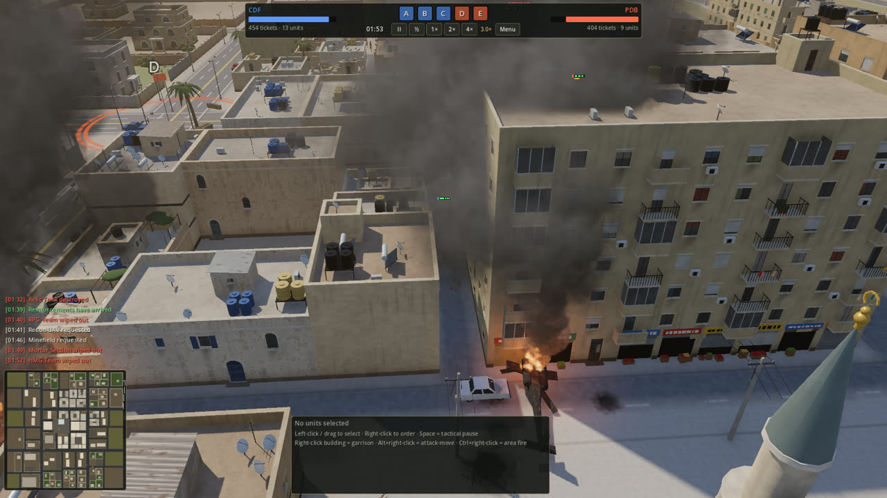
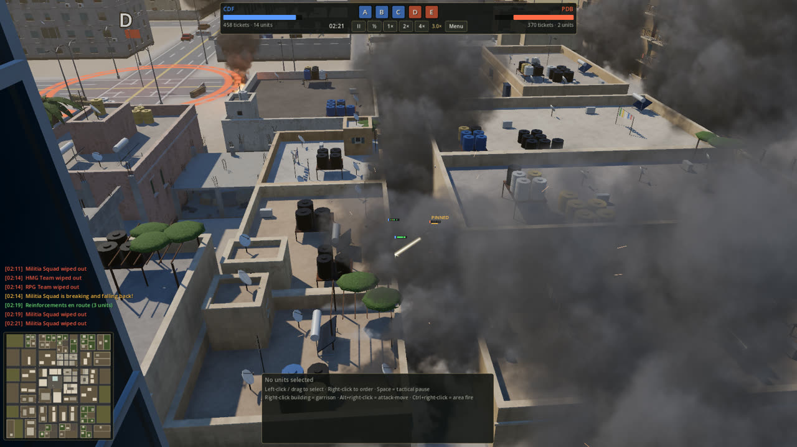
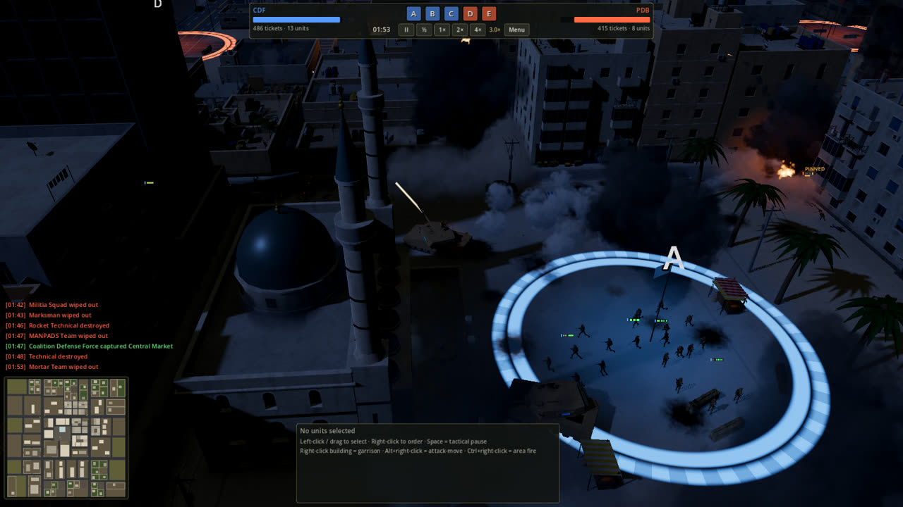
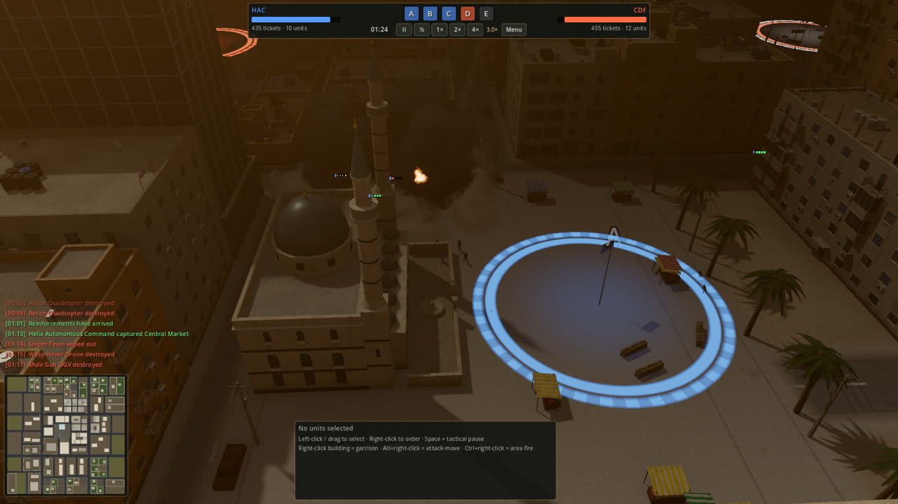
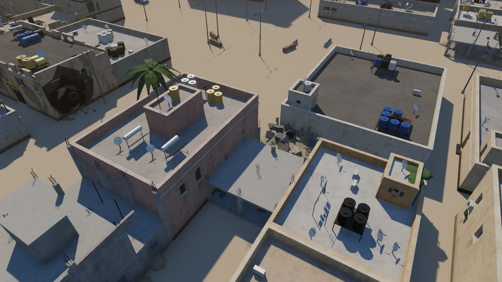
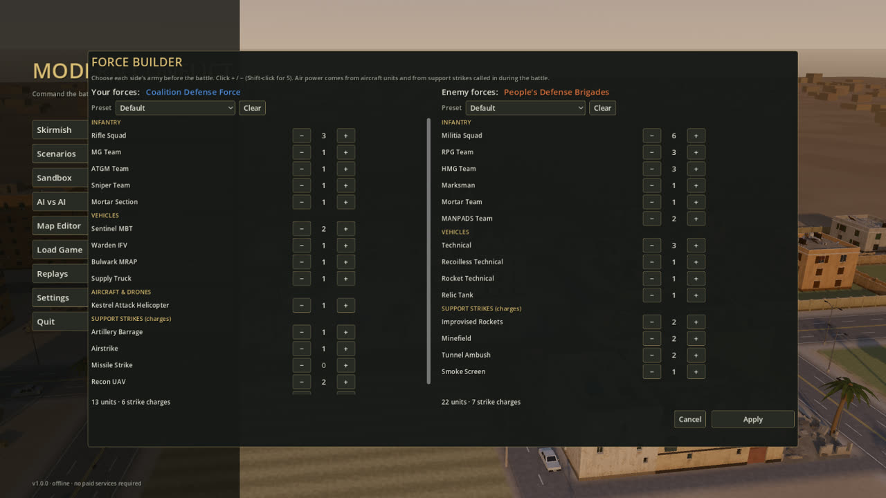
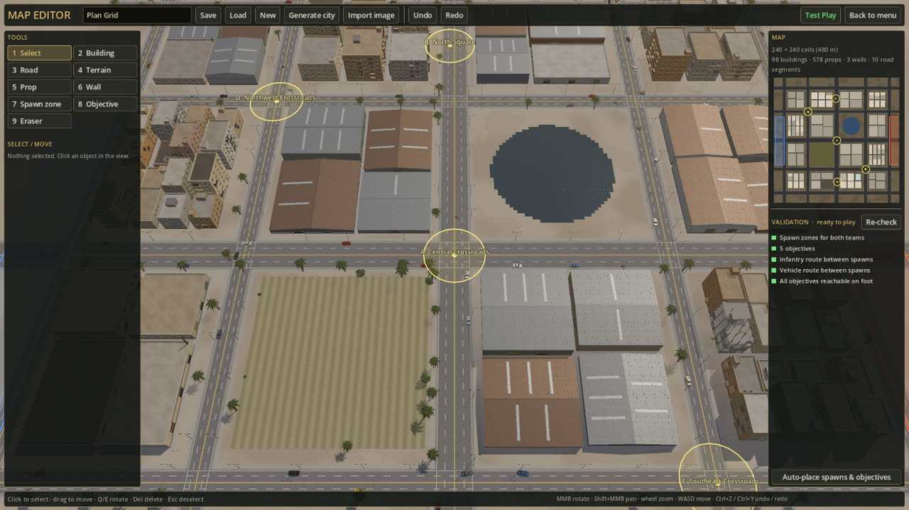

# Modern Conflict

**A modern-warfare real-time strategy game with tactical pause.** Command infantry, armor, helicopters, drones and robots in a living, destructible Middle-Eastern city. No base building, no economy, just decisions and their consequences.

[](https://github.com/ahmad-alismail/modern-conflict/actions/workflows/tests.yml)
[](https://github.com/ahmad-alismail/modern-conflict/releases/latest)
[](LICENSE)
[](https://godotengine.org)



Built with **Godot 4.7 (GDScript)** as a native Windows desktop game. Every building, vehicle, soldier, effect and sound is **generated procedurally**, so there are no asset files to license. That also makes the game easy to modify and extend.

---

## Play now (Windows)

1. Go to **[Releases](https://github.com/ahmad-alismail/modern-conflict/releases/latest)** and download **`ModernConflict.exe`**.
2. Double-click it. There is nothing to install and it works fully offline.
3. If Windows shows *"Windows protected your PC"*, click **More info → Run anyway**. The executable isn't code-signed.

The game starts fullscreen (toggle with **F11**). Pick **Skirmish** for a quick battle, or **Scenarios** for the five missions. Linux and macOS players can run it from source (see below).

## What makes it different

- **Three asymmetric factions that really play differently**
  - **Coalition Defense Force:** tanks, IFVs, attack helicopters, thermal sights, artillery and missile strikes.
  - **People's Defense Brigades:** numerous concealed infantry, technicals, RPG ambushes from buildings, tunnels and minefields.
  - **Helix Autonomous Command:** robot dogs, unmanned ground vehicles, FPV and armed drones, sensor masts and jamming. Its robots depend on a network link.
- **A believable battlefield**
  - Real line of sight through a 3D city, fog of war, cover and garrisoned buildings.
  - Suppression, pinning and broken morale. Soldiers who break run for the rear.
  - Armor penetration by facing (front, side, rear, top), limited ammo and resupply, smoke.
  - **Destruction is permanent:** buildings collapse into rubble that changes movement and sightlines, and wrecks keep burning.
- **Tactical pause:** press **Space**, give orders calmly, resume.
- **Force Builder:** choose *your* army and *the enemy's* before the battle. Presets or any composition you like: Armored, Infantry, Air & Drones, Artillery & Missiles.
- **Living environments:** procedurally generated cities (old quarter, souq, mosque, apartment blocks, walled villas, industrial zone), day, dusk, dawn and night, haze, dust storms and rain.
- **Map editor with image import:** draw a map by hand, or upload a plan, sketch or map screenshot and get a playable 3D city you can edit.
- **An offline AI that doesn't cheat:** Easy, Medium and Hard differ in decision quality only. The AI sees only what its units see.
- **Optional LLM commanders:** let a local model (Ollama, LM Studio) or Claude command a side, and watch AI-vs-AI with their reasoning. Never required, never enabled automatically.
- **Save/load and replays:** the simulation is deterministic, so a replay is an exact re-run of the battle.

| | |
|---|---|
|  |  |
|  |  |
|  |  |

## How to play

**Goal:** objectives **A–E** are circles with flags. Any of your **ground units** standing in a circle captures it: infantry at full speed, vehicles at half speed, aircraft not at all. Enemy units inside contest it. While you hold more objectives than the enemy, their **tickets** drain. Every unit you lose costs tickets too, and the side that hits 0 loses.

| | Controls |
|---|---|
| **Camera** | **Hold right mouse + drag** to pan · WASD / arrows / screen edge · mouse wheel to zoom (zoom in for a cinematic view) · Q/E or middle-drag to rotate · F to follow a unit |
| **Select** | Left-click · drag a box · Shift to add · double-click for all units of that type · Ctrl+1–9 to set a group, 1–9 to recall it |
| **Orders** | **Right-click**: move / attack an enemy / garrison a building / board a transport · Alt+right-click to attack-move · Ctrl+right-click for area fire (mortars) · Shift to queue |
| **Commands** | T attack-move · X stop · H hold · G leave building · U unload · C smoke · R retreat · V stance |
| **Support** | F1–F4 support strikes (then click the target) · F5 reinforcements |
| **Time** | **Space tactical pause** · + / − game speed |
| **Window** | F11 or Alt+Enter toggles fullscreen |

**Tips:** infantry inside buildings is hard to see and hit. Tanks are weakest from the sides, rear and above. Bring infantry with your armor, and pull back badly damaged units, because losses cost tickets.

## Run or build from source (Windows, Linux, macOS)

You need **Git** and a **Bash** shell (on Windows, Git Bash comes with Git).

```bash
git clone https://github.com/ahmad-alismail/modern-conflict.git
cd modern-conflict
tools/setup.sh        # downloads Godot 4.7.2 into .tools/ (git-ignored) and imports the project
tools/gd.sh run       # play from source
```

| Command | What it does |
|---|---|
| `tools/gd.sh run` | play the game (dev shortcuts: `--screen=skirmish`, `--screen=scenario:iron_sky`, `--screen=editor`, `--seed=7`, `--faction=hac --enemy=cdf`, `--tod=night`) |
| `tools/gd.sh test` | run the headless test suite (`tools/gd.sh test sim` for one file) |
| `tools/gd.sh check` | parse-check every script |
| `tools/gd.sh editor` | open the project in the Godot editor |
| `tools/gd.sh shot out.png 8 --screen=skirmish` | take a screenshot (saved to `shots/`) |
| `tools/setup.sh --templates` then `tools/gd.sh export` | build `build/ModernConflict.exe` |

Already have Godot 4.7.2? Skip setup and point the helper at it: `GODOT=/path/to/godot tools/gd.sh run`.

## Optional: LLM commanders

Settings → **LLM Commander**: enable it, then pick **Ollama** (local), any **OpenAI-compatible** server (e.g. LM Studio), or **Anthropic Claude** (cloud). **Test connection** lists your models without spending anything. Cloud providers require an explicit paid-service consent checkbox. If a model fails repeatedly, the classic AI takes over, so a match never depends on it.

## Contributing

**Contributions are very welcome.** There is plenty of fun work for every skill level: new units, scenarios, AI tactics, visuals, sound, UI, maps, multiplayer. Start with **[CONTRIBUTING.md](CONTRIBUTING.md)**, which covers setup, architecture, workflow and good first issues. You can also browse issues labeled [`good first issue`](https://github.com/ahmad-alismail/modern-conflict/labels/good%20first%20issue).

Project docs:
- [docs/ARCHITECTURE.md](docs/ARCHITECTURE.md): how the deterministic simulation, AI and presentation fit together.
- [docs/CONTRACTS.md](docs/CONTRACTS.md): interfaces of the procedural art, effects and audio modules.
- [vision.md](vision.md): the original game vision.

## Known limitations

- **Procedural art.** Models are built from code, not sculpted, so the look relies on lighting, atmosphere and detail density. Real glTF models can be dropped in behind `UnitModels` / `BuildingBuilder`.
- **Untested audio.** Sound is synthesized and tuned from waveform analysis but hasn't been listened to properly yet. The mix needs ears.
- **LLM commander coverage.** It was verified with local Ollama. The OpenAI-compatible and Claude paths follow the documented APIs.
- **Balance** comes from automated AI-vs-AI batches. Human play will surface new strategies.
- **No multiplayer yet.** The deterministic simulation and command stream are a natural basis for lockstep networking.

## License

[Apache License 2.0](LICENSE). See also [NOTICE](NOTICE). All factions, places, units and events are fictional.
